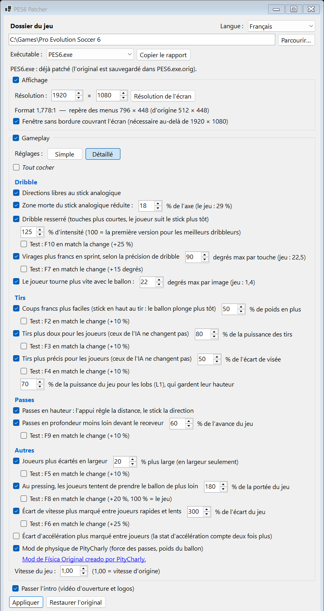

# PES6 Patcher

*[English](README.md) | Français* · [Site web](https://kwentinn.github.io/PES6Patcher/fr/)

Patch pour **Pro Evolution Soccer 6 (PC)** : affichage écran large sans étirement (16:9, 21:9, 32:9…), déplacement libre au stick analogique (dribble compris), dribble resserré en option, coups francs plus faciles, tirs plus doux et plus précis, et plus d'intro au démarrage.



## Ce que fait le patch

**Affichage écran large**
- Les menus, les listes, le HUD (score, chrono, radar, noms) et le curseur du joueur ne sont plus étirés. Ils gardent leurs proportions d'origine, au centre de l'écran.
- L'image 3D est adaptée au format de l'écran avec LOD Mixer.
- Au-delà de 1920 × 1080 (écrans 1440p, ultra-larges), le jeu s'ouvre dans une fenêtre sans bordure qui couvre tout l'écran.

**Gameplay**
- **Directions libres au stick analogique** : le joueur suit l'angle précis du stick au lieu des seules 8 directions d'origine, en course comme en dribble (le ballon part dans l'angle du stick au lieu du multiple de 22,5° le plus proche). La croix directionnelle, le clavier et l'IA ne changent pas.
- **Zone morte du stick analogique réduite** (activée par défaut) : le jeu met à zéro chaque axe du stick à moins de 29 % du centre, si bien qu'un stick tenu jusqu'à environ 16° du haut, du bas, de la gauche ou de la droite est lu pile sur cet axe, et le joueur continue sur une ligne. Cette option réduit cette zone (**18 %** par défaut, de 2 à 26 %) : un léger mouvement du stick oriente maintenant le joueur. Elle vaut pour les deux sticks ; augmentez-la si votre manette dérive. Sur les corners, les coups francs et les 6 mètres, la visée ignore alors une légère poussée (moins de 3/8 de la course du stick) et tourne d'autant plus vite que le stick est poussé, jusqu'à la vitesse du jeu ; de même pour le placement du ballon à l'entraînement aux coups francs. La croix directionnelle garde la vitesse du jeu.
- **Dribble resserré** (option) : en dribble, le joueur ne peut changer de direction qu'à sa touche de balle suivante. Cette option raccourcit les touches : le ballon reste plus près et le joueur suit le stick plus tôt. La réduction suit la précision de dribble du joueur : aucune jusqu'à 65 (touches d'origine du jeu), complète à partir de 95 (× 0,875 en course, × 0,81 en sprint), proportionnelle entre les deux. Les bons dribbleurs gardent donc le ballon plus près que les mauvais. Son **intensité** règle la part de cette réduction appliquée (125 % par défaut, de 50 à 200 % ; au-delà, le joueur marche sur le ballon ; avec la case **Test**, F10 en match ajoute 25 % et affiche la valeur) : à 200 %, un dribbleur noté 95 ou plus a × 0,75 en course et × 0,625 en sprint. Les passes et les tirs ne changent pas. En match, **F1** l'active et le désactive ; l'état s'affiche un instant à l'écran (via Kitserver), ainsi qu'au coup d'envoi.
- **Coups francs plus faciles** (option) : après un tir de coup franc direct, stick gauche poussé vers le haut au moment de la frappe, le ballon est plus lourd jusqu'à la touche suivante (+50 % par défaut, réglable de 10 à 200 % ; avec la case **Test**, F2 en match ajoute 10 % et affiche la valeur, pour trouver le bon réglage) : il plonge plus tôt derrière le mur. Sans le stick en haut, et dans le reste du jeu, le ballon garde son poids normal ; le gardien et l'IA voient la même trajectoire.
- **Tirs plus doux** (option) : pour les équipes des joueurs seulement, la puissance au-delà du tir le plus léger est réduite (80 % par défaut, réglable de 50 à 90 % ; avec la case **Test**, F3 en match ajoute 10 % et affiche la valeur). Les tirs de l'IA et les coups de pied arrêtés ne changent pas.
- **Tirs plus précis** (option) : pour les équipes des joueurs seulement, l'écart de visée du jeu (direction et hauteur) est réduit (à 50 % par défaut, réglable de 0 à 90 % ; avec la case **Test**, F4 en match ajoute 10 % et affiche la valeur) : un tir pris dans une position inconfortable ne part plus loin du cadre. Un tir du mauvais pied, que le jeu dévie davantage (et toujours du même côté), garde le carré de cette part : 25 % à 50 %. La part suit ensuite la précision de tir du tireur, la stat sur laquelle le jeu tire ses ratés (y compris sous pression, avec un adversaire proche) : gardée jusqu'à 75, elle baisse de 4 % par point au-dessus (moitié à 88, un cinquième dès 95), si bien qu'un grand attaquant n'envoie plus le ballon dans les tribunes alors qu'un joueur moyen rate encore. Un lob (L1 tenu) garde sa hauteur, voulue et non une erreur, et reçoit moins de puissance (70 % par défaut, de 40 à 100 %), pour ne plus passer au-dessus du gardien et du but. Les tirs de l'IA et les coups de pied arrêtés ne changent pas (les coups francs gardent leur hauteur pour passer le mur).
- **Têtes plus douces** (option, en test) : pour les équipes des joueurs seulement, la hauteur des têtes est réduite (70 % par défaut, réglable de 30 à 90 % ; avec la case **Test**, F11 en match ajoute 10 % et affiche la valeur), pour qu'une tête ne passe plus au-dessus de la barre. Les têtes de l'IA ne changent pas.
- **Joueurs plus écartés en largeur** (option) : les joueurs qui se replacent se tiennent plus loin du centre de leur équipe en largeur (+20 % par défaut, réglable de 10 à 40 % ; F5 en match avec la case **Test**). Les lignes gardent leur hauteur : seule la largeur change, ce qui laisse plus d'espace pour dribbler et passer. Les deux équipes sont concernées.
- **Écart de vitesse plus marqué entre joueurs rapides et lents** (option) : dans PES6, chaque point de la stat de vitesse de pointe ne vaut que 20 unités de vitesse maximale, si bien qu'un joueur à 97 n'est que 7 % plus rapide qu'un joueur à 68. Cette option donne plus de poids à la stat (300 % par défaut, réglable de 100 % = le jeu à 400 % ; avec la case **Test**, F6 en match ajoute 25 % et affiche la valeur), autour d'un joueur à 75 qui garde sa vitesse : à 300 %, l'écart passe à environ 22 %. Un ailier rapide peut distancer un défenseur plus lent, avec ou sans ballon. Les deux équipes sont concernées ; le jeu recalcule la vitesse maximale pendant le match, un changement s'applique donc tout de suite.
- **Écart d'accélération plus marqué entre joueurs** (option) : dans PES6, la stat d'accélération ne retire qu'un peu du temps qu'il faut à un joueur pour atteindre sa vitesse (de 0 jusqu'à 50 à environ 9 unités à 99, sur 28 à 48), si bien qu'un joueur explosif comme Messi se distingue à peine. Cette option la fait compter deux fois plus : les meilleurs démarrent nettement plus vite sur les premiers pas. Quatre fois plus a été essayé et faisait traverser le terrain aux meilleurs en un instant. Les deux équipes sont concernées.
- **Virages plus francs en sprint, selon la précision de dribble** (option) : en sprint balle au pied, PES6 ne tourne le ballon que de 22,5° au plus par touche, une touche toutes les 0,7 s, si bien qu'un quart de tour prend environ 3 secondes « par paliers ». Avec cette option, la limite suit la précision de dribble du joueur : les 22,5° du jeu jusqu'à 65, puis de plus en plus, jusqu'au maximum choisi à partir de 95 (90° par défaut, réglable à partir de 45° ; avec la case **Test**, F7 en match ajoute 15° et affiche la valeur). À une touche qui tourne le ballon de plus de 22,5°, le joueur tourne avec lui aussitôt, sur l'un ou l'autre pied, au lieu de continuer sur son ancienne ligne. À partir de 45° entre le stick et le joueur (le jeu : 112°), c'est l'animation de virage du jeu qui se joue, au lieu d'une touche de sprint. Les grands dribbleurs peuvent changer de direction franchement, les dribbleurs faibles gardent les virages du jeu. Les deux équipes sont concernées.
- **Le joueur tourne plus vite avec le ballon** (option) : en course balle au pied, PES6 ne tourne le joueur que de 1,4° au plus par image, alors qu'une touche brusque envoie le ballon ailleurs d'un coup : le joueur continue sur son ancienne ligne pendant une demi-seconde et laisse le ballon à plusieurs mètres. Cette option le laisse tourner jusqu'à **22° par image** par défaut (environ 16 fois plus vite, réglable de 3 à 45°), pour qu'il suive le ballon. Les deux équipes sont concernées ; elle va bien avec les virages plus francs en sprint.
- **Passes en hauteur : l'appui règle la distance, le stick la direction** (option) : une passe en hauteur (rond) vise un coéquipier choisi d'après la jauge de puissance et le stick, mais la jauge monte si vite qu'un appui court vise déjà loin, et le jeu prend n'importe quel coéquipier à moins de 45° du stick : la passe semble entièrement assistée. Avec cette option, un appui court ou moyen vise nettement plus près (la passe la plus longue ne change pas), et le receveur doit être à moins de 22,5° du stick ; s'il n'y en a pas, la passe part dans la direction du stick. Les centres ne changent pas.
- **Passes en profondeur moins loin devant le receveur** (option) : une passe en profondeur va au bon coéquipier, mais le jeu la vise loin devant lui, et sur les ailes elle sort presque toujours en touche. Cette option réduit cette avance (60 % par défaut, de 30 à 90 % ; avec la case **Test**, F9 en match ajoute 10 % et affiche la valeur), pour que le ballon arrive dans la course du receveur. Les deux équipes sont concernées.
- **Au pressing, les joueurs tentent de prendre le ballon de plus loin** (option) : au pressing avec la croix, PES6 amène le joueur à côté du porteur, mais ne tente de prendre le ballon qu'à moins de 160 unités, plus près que là où il s'arrête, si bien qu'il ne tente presque jamais. Cette option élargit cette portée (180 % par défaut, réglable à partir de 120 % ; avec la case **Test**, F8 en match ajoute 20 %, 100 % étant celle du jeu, et affiche la valeur). Les joueurs qui pressent vont chercher le ballon. Les deux équipes sont concernées.
- **Vitesse du jeu** réglable (module Speeder de Kitserver).
- **Mod de physique de PityCharly** (option, téléchargement séparé) : passes en une touche et passes courtes plus appuyées, poids du ballon ajusté en dribble. Voir [Mod de physique](#mod-de-physique).

Le reste du gameplay est inchangé.

**Démarrage**
- **Passer l'intro** (cochée par défaut) : plus de vidéo d'ouverture ni de logos au démarrage. Le choix de la langue et le chargement du fichier d'options sont conservés.

## Prérequis

- **PES6 PC avec un exécutable non protégé** : `PES6.exe` « No-DVD » 1.00 ou 1.10, ou l'exe d'un patch communautaire. Voir [Exécutables pris en charge](#exécutables-pris-en-charge).
- **[Kitserver 6](https://www.evoweb.uk/)**, avec les modules LOD Mixer et Speeder. Il sert à régler la résolution et le format 3D.
- **Windows 10/11** et le **.NET 10 Desktop Runtime**.

## Utilisation

1. Fermer PES6 et `settings.exe`.
2. Lancer `PES6Patcher.exe`. Il demande les droits administrateur, car le jeu est installé dans `Program Files`.
3. Vérifier le dossier du jeu (détecté automatiquement), l'exécutable et la résolution (celle de l'écran par défaut).
4. Choisir les options (voir ci-dessous), puis cliquer sur **Appliquer**. Chaque groupe (**Affichage**, **Gameplay**) et **Passer l'intro** peuvent être décochés : par exemple, pour ne modifier que le gameplay, décocher **Affichage**, et `kload.cfg`, `lodmixer.dat` et `settings.dat` restent tels quels.

Les options de gameplay ont deux modes, retenus d'une ouverture à l'autre :

- **Simple** : trois profils règlent toutes les options d'un coup. **Pro** (choisi au départ) correspond aux valeurs par défaut du patcher, testées en match ; **Normal** aide davantage, **Hardcore** moins. Quand les options ne correspondent à aucun profil (modifiées en mode détaillé), la fenêtre indique qu'elles sont personnalisées.
- **Détaillé** : chaque option et sa valeur, avec les cases **Test**. Choisir d'abord un profil, puis ajuster quelques valeurs ici, est le moyen le plus rapide de régler le jeu.

| Profil | Dribble resserré | Virages en sprint | Rotation balle au pied | Coups francs | Puissance des tirs | Écart de visée gardé | Avance des passes |
|---|---|---|---|---|---|---|---|
| Normal | 150 % | 90° | 22° | +70 % | 75 % | 30 % | 50 % |
| Pro | 125 % | 90° | 22° | +50 % | 80 % | 50 % | 60 % |
| Hardcore | 100 % | 45° | 11° | +30 % | 90 % | 75 % | 80 % |

Les autres options sont les mêmes dans tous les profils : directions libres, zone morte du stick 18 %, passes en hauteur, lobs 70 %, écartement 20 %, portée des tacles 180 %, écart de vitesse 300 %, écart d'accélération plus marqué.

L'exe est toujours reconstruit à partir de la sauvegarde d'origine : on peut changer les options et réappliquer à tout moment. Chaque application enregistre ses options à côté de l'exe (`PES6.exe.patcher.ini`, une simple liste de `Nom=valeur`) : quand la fenêtre s'ouvre sur un exe patché ainsi, elle affiche les options de cet exe, prêtes à être modifiées. Un exe patché avant la version 1.19.0 affiche les options par défaut jusqu'à la prochaine application.

**Restaurer l'original** remet tous les fichiers tels qu'ils étaient avant la première application.

Remarques :
- Après application, ne pas rouvrir `settings.exe` : il ne connaît pas les résolutions au-delà de 1920 × 1080 et remettrait l'ancienne valeur.
- Rester en mode fenêtré dans le jeu. La fenêtre sans bordure couvre déjà tout l'écran.

## Fichiers modifiés

| Fichier | Modification | Sauvegarde |
|---|---|---|
| `PES6.exe` (ou l'exécutable choisi) | patch (voir ci-dessous) | `PES6.exe.orig` |
| `kitserver\kload.cfg` | résolution de rendu (une résolution interne plus grande de même format est conservée), fenêtre sans bordure, ligne du mod de physique dans la liste des DLL | `kload.cfg.orig` |
| `kitserver\lodmixer.dat` | format d'image 3D (laissé tel quel si son format n'est pas reconnu) | `lodmixer.dat.orig` |
| `kitserver\speeder.cfg` | vitesse du jeu | `speeder.cfg.orig` |
| `Documents\KONAMI\Pro Evolution Soccer 6\settings.dat` | résolution du jeu, somme de contrôle recalculée | `settings.dat.orig` |

## Fonctionnement

Le jeu dessine ses menus dans un repère hérité de la PS2, de **512 × 448** unités, puis l'étire sur toute la largeur de l'écran. Le patch élargit ce repère à **448 × format** unités, par exemple 796 × 448 en 16:9. Le rendu 3D et le gameplay continuent d'utiliser les valeurs d'origine.

| Élément | Modification |
|---|---|
| Conversion repère 2D → pixels | 13 instructions graphiques lisent de nouvelles constantes (demi-largeur, 1/largeur) au lieu de 256 et 1/512. Les instructions de gameplay qui lisent ces mêmes constantes ne sont pas touchées. |
| Largeur du repère 2D | La fonction qui renvoie 512 renvoie la nouvelle largeur. Les deux appels qui alimentent la projection 3D gardent 512, sinon les joueurs « glissent ». |
| Découpage des listes | Code ajouté avant la conversion du rectangle de découpage en pixels. |
| Curseur du joueur | Code ajouté qui ajuste l'échelle de la projection 3D → repère 2D. |
| Directions libres | Code ajouté autour de la conversion bits de direction → cap : ajoute l'écart entre l'angle précis du stick et le centre de son secteur de 45°. Le seuil de virage de la course passe de 45° à environ 17°. Pour la touche de dribble la plus fréquente, dont le jeu arrondit la direction à 22,5°, du code ajouté à l'entrée de la fonction qui frappe le ballon rajoute ce que l'arrondi a retiré (pour la manette dont le stick donne cette direction). |
| Zone morte du stick | Le lecteur de manette met à zéro chacun des 4 axes des sticks (octets 0-255, centre 128) quand il est à 37 ou moins du centre (`cmp eax,25h`). Les 4 limites sont abaissées sur place (18 % de 127 = 23). La zone morte centrale du jeu, appliquée plus tard aux deux axes ensemble, ne change pas. Les attentes de corner et de coup franc tournaient la visée de 0x40 fixes par image dès que le stick penchait à droite ou à gauche (0x80 aux 6 mètres) : un crochet ramène ce pas à 0 sous la force 3 (sur 8), puis au carré de la force (9 à 64 = 0x40, doublé aux 6 mètres) ; une force de 0 (croix) garde le pas entier. Le placement du ballon à l'entraînement aux coups francs le déplace de 0x40 par image et par direction : même pas, pris sur le stick le plus poussé. |
| Dribble resserré | Code ajouté à l'entrée de la fonction qui frappe le ballon : quand l'appel vient d'une des 7 touches de dribble (5 en course, 2 en sprint), la vitesse de frappe est réduite selon la précision de dribble du joueur (la stat que le jeu lit pour l'imprécision de direction des touches), fois l'intensité (une constante, ou un mot lu en cours de jeu avec F10). |
| Coups francs | L'appel de la fonction de tir par le code des coups de pied arrêtés passe par du code ajouté qui marque la frappe quand un stick gauche est poussé vers le haut (le jeu lit le stick pour l'effet du tir à ce même moment, et ne le relit plus pendant le vol) ; le vol du ballon (utilisé aussi par les prédictions de trajectoire) ajoute alors la part choisie du poids du ballon jusqu'à la frappe suivante. La constante de poids du jeu n'est pas modifiée (le mod de physique de PityCharly la change pendant le jeu). |
| Tirs | L'entrée de la fonction de tir passe par du code ajouté qui garde la direction demandée et, pour un tireur d'une équipe humaine, réduit la puissance au-delà du tir le plus léger ; l'appel de la fonction de frappe par le tir passe par du code qui rapproche la direction et la hauteur finales de celles demandées (tirs plus précis), davantage pour un tir du mauvais pied (pied de l'animation comparé au pied fort, comme le fait le jeu). Les équipes humaines sont reconnues aux commandes des joueurs actifs qui correspondent aux manettes (un score par équipe, rangé selon l'équipe du joueur actif pour suivre le changement de côté à la mi-temps). Les coups de pied arrêtés gardent la puissance du jeu. |
| Têtes | Code ajouté à l'entrée de la fonction de frappe : pour un joueur d'une équipe humaine dont l'état (`+0x16`) est une tête (30 ou 34), l'argument de hauteur est multiplié par la part choisie, la vitesse est gardée (avec F11, lue pendant le jeu). |
| Écartement | La fonction qui fixe où un joueur se place (joueur, x, z) passe par du code ajouté : pour un joueur qui se replace, gardiens exceptés, la cible est éloignée du centre des cibles de son équipe en largeur (z) de la part choisie. La longueur (x) ne change pas : les lignes gardent leur hauteur. |
| Écart de vitesse | La vitesse maximale de chaque joueur est calculée, et recalculée pendant le match : 7542 + 12 × (vitesse de pointe − 40) × 100 / 60 − 16 × fatigue, dans une section exécutable de la protection. Ce calcul saute vers du code ajouté qui multiplie la part de la stat par le réglage choisi, autour d'un joueur à 75. |
| Écart d'accélération | Chaque appel de la rampe de vitesse (`0x48FEF0`, dans la protection) passe un temps d'accélération : une base, moins la stat d'accélération (`0x3BCF5AF`) au-dessus de 50 ramenée de 0 à 98 et divisée par 10 (`imul 66666667h ; sar edx,2`), qui ne retire donc que 0 à 9. Les 55 `sar edx,2` qui suivent une lecture de la stat deviennent `sar edx,1` (division par 5). |
| Virages en sprint | À chaque foulée de sprint, le jeu tourne la direction du ballon depuis celle du joueur (arrondie à 22,5°) vers le stick, d'au plus 22,5°. Cette limite est remplacée par du code ajouté qui la calcule à partir de la précision de dribble du porteur. Avant chacune des deux touches de sprint (une par pied), un autre code ajouté compare la nouvelle direction à celle du ballon et, quand le virage dépasse 22,5°, y tourne la course et l'orientation du joueur. Un octet de la foulée de sprint confie les virages à partir de 45° (au lieu de 112°) à la foulée de dribble normale, qui joue l'animation de virage. |
| Virages avec le ballon | En course balle au pied, le jeu tourne l'orientation et la course du joueur vers leur cible d'au plus 0x100 (1,4°) par image, à deux endroits (`push 100h`, `add ecx,100h`). Les deux pas sont relevés sur place à l'angle choisi (22° = 0xFA5). |
| Tacle au pressing | Dans l'état de pressing, la tentative de prise de balle n'est demandée qu'à moins de 160 unités du ballon, et la tentative elle-même ne se poursuit qu'à moins d'environ 210 en course. Les deux limites sont multipliées par le réglage choisi (deux valeurs dans l'exe ; avec F8, un saut vers du code ajouté qui lit le réglage pendant le match). |
| Visée des passes en hauteur | Le receveur de la passe en hauteur est choisi d'après la jauge de passe (une distance voulue) et le stick. Deux valeurs de ce choix sont changées dans l'exe : la conversion jauge → distance devient quadratique, et le cône autour du stick passe de 45 à 22,5 degrés. |
| Avance des passes | Le point visé d'une passe est placé devant le receveur, d'une avance construite d'après sa course. Les deux endroits qui lisent cette avance pour placer le point sautent vers du code ajouté qui la multiplie par le réglage choisi (avec F9, lu pendant le match). |
| Intro | Le jeu sait déjà sauter la vidéo d'ouverture quand on le lui demande, et passer un logo quand on appuie sur une touche : ces deux chemins sont toujours pris (3 sauts conditionnels neutralisés). Le chargement fait pendant les logos a toujours lieu. |

Le code ajouté est placé dans des zones de remplissage inutilisées de l'exe. Quand un exe en a trop peu (certains patchs communautaires), le patcher ajoute à la place une petite section `.pch` en fin de fichier.

## Exécutables pris en charge

PES6 existe en plusieurs versions : 1.00 et 1.10, d'origine ou « No-DVD », sans compter les exécutables fournis par les patchs communautaires (`online_pes6.exe`, `offline_pes6.exe`…). Le patch ne repose pas sur des adresses fixes : il **retrouve chaque emplacement par signature**, c'est-à-dire par le code qui l'entoure, avec les adresses laissées en joker. Il en déduit ensuite les adresses dont il a besoin, puis les vérifie : les constantes doivent valoir 256,0 et 1/512, les appels doivent mener aux bonnes fonctions… Toute version qui contient le même code du jeu est donc patchée de la même façon, quel que soit l'endroit où ce code se trouve.

Pour l'exécutable choisi, l'application indique :
- **version testée en jeu** : le patch est connu pour fonctionner ;
- **pas encore testée en jeu** : tous les emplacements ont été trouvés, le patch devrait donc fonctionner. Merci d'indiquer ce que ça donne ;
- **non prise en charge** : certains emplacements sont introuvables. Rien n'est modifié.

Les exécutables d'origine qui vérifient le DVD gardent peut-être une partie de leur code chiffrée par la protection anticopie. Dans ce cas, l'application les signale comme non pris en charge, et il faut un exécutable « No-DVD ».

**Copier le rapport** place un court rapport dans le presse-papiers : nom du fichier, SHA-256, ce qui peut être appliqué et emplacements introuvables. Merci de le partager, par exemple sur le fil du forum, pour que d'autres versions puissent être confirmées.

Versions testées en jeu :

| SHA-256 | Remarques |
|---|---|
| `3FE13850C933C85385F3FB5C45977D2DAA860D1FC03E95E97BE9F4FC24D81382` | `PES6.exe` « No-DVD » : écran large (16:9, 32:9), directions libres (course et dribble), dribble resserré, coups francs, tirs plus doux et plus précis, et saut de l'intro testés |

Le détail des adresses et de la méthode, avec Ghidra, des points d'arrêt matériels et des relevés mémoire, est dans [`research/NOTES.fr.md`](research/NOTES.fr.md). Les scripts utilisés pendant la recherche sont dans [`research/scripts`](research/scripts).

## Limites

- Une seule version a été testée en jeu pour l'instant. Les autres sont patchées si leur code correspond (voir plus haut).
- Les décors des menus font 512 unités de large : il reste des bandes noires sur les côtés.
- Les directions libres ne concernent que le stick analogique. Quelques touches de dribble moins fréquentes et les gestes spéciaux gardent les directions du jeu.
- Le dribble resserré s'applique à tous les joueurs, IA comprise : ses bons dribbleurs gardent eux aussi le ballon plus près, ce qui les rend plus difficiles à arrêter. Le désactiver avec F1 si défendre devient trop dur.
- À deux joueurs sur le même PC, les directions libres choisissent la manette dont le stick correspond à la touche de dribble ; ce cas n'a pas été testé.

## Traductions

L'application est disponible en anglais et en français. La langue suit celle de Windows et peut être changée dans la fenêtre.

Pour ajouter une langue : copier `src/PES6Patcher.Core/Resources/Strings.resx` en `Strings.<code>.resx` (par exemple `Strings.es.resx`), traduire les valeurs en gardant les paramètres `{0}`, `{1}`…, puis proposer une pull request. La nouvelle langue apparaît automatiquement dans l'application, et les tests vérifient qu'elle a les mêmes clés et paramètres que l'anglais.

## Compiler

```powershell
dotnet build
dotnet test
dotnet publish src/PES6Patcher -c Release -o publish -p:PublishSingleFile=true --self-contained false
```

Les tests comparent l'exe produit avec des exe validés en jeu. Ces fichiers viennent du jeu et ne sont donc pas dans le dépôt : sans eux, ces tests passent sans rien vérifier.

## Mod de physique

[pes6_game_physics_mod](https://github.com/angelballay/pes6_game_physics_mod), de PityCharly, est une DLL Kitserver qui ajuste la force des passes (surtout en une touche) et le poids du ballon pendant le jeu. Le patcher ne l'inclut pas : il l'active ou la désactive seulement dans `kload.cfg`.

1. Télécharger `pes6_game_physics_mod.zip` depuis [les releases du mod](https://github.com/angelballay/pes6_game_physics_mod/releases).
2. Copier **seulement** `pes6_game_physics_mod.dll` dans le dossier `kitserver` du jeu. Ne pas copier le `kload.cfg` de l'archive : il remplacerait le vôtre (liste des DLL, résolution).
3. Dans le patcher, cocher **Mod de physique de PityCharly**, puis cliquer sur **Appliquer**. Seule sa ligne est ajoutée à la liste des DLL (et retirée si on décoche) ; le reste de `kload.cfg` ne change pas.

Le mod utilise les adresses du `PES6.exe` testé (voir [Exécutables pris en charge](#exécutables-pris-en-charge)). Il ne touche pas au code modifié par ce patcher. En jeu, Ctrl+Maj+P l'active et le désactive.

## Crédits

- **Mod de Física Original creado por PityCharly.** ([pes6_game_physics_mod](https://github.com/angelballay/pes6_game_physics_mod), licence MIT avec une condition d'attribution.)
- [Kitserver](https://www.evoweb.uk/), de juce et de l'équipe Kitserver.

## Avertissement

Projet non officiel, sans lien avec Konami. Aucun fichier du jeu n'est inclus : l'application modifie uniquement l'installation présente sur la machine, après en avoir fait une sauvegarde. Utilisation à vos risques.

## Licence

[MIT](LICENSE)

