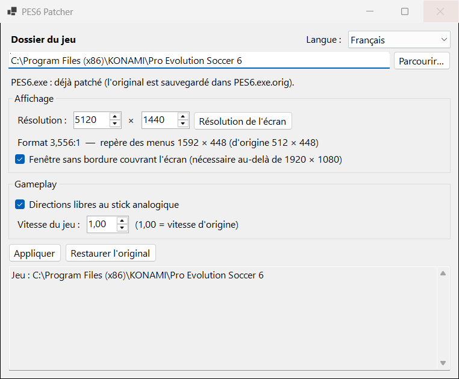

# PES6 Patcher

*[English](README.md) | Français*

Patch pour **Pro Evolution Soccer 6 (PC)** : affichage écran large sans étirement (16:9, 21:9, 32:9…), déplacement libre au stick analogique (dribble compris), dribble resserré en option, coups francs plus faciles, et plus d'intro au démarrage.



## Ce que fait le patch

**Affichage écran large**
- Les menus, les listes, le HUD (score, chrono, radar, noms) et le curseur du joueur ne sont plus étirés. Ils gardent leurs proportions d'origine, au centre de l'écran.
- L'image 3D est adaptée au format de l'écran avec LOD Mixer.
- Au-delà de 1920 × 1080 (écrans 1440p, ultra-larges), le jeu s'ouvre dans une fenêtre sans bordure qui couvre tout l'écran.

**Gameplay**
- **Directions libres au stick analogique** : le joueur suit l'angle précis du stick au lieu des seules 8 directions d'origine, en course comme en dribble (le ballon part dans l'angle du stick au lieu du multiple de 22,5° le plus proche). La croix directionnelle, le clavier et l'IA ne changent pas.
- **Dribble resserré** (option) : en dribble, le joueur ne peut changer de direction qu'à sa touche de balle suivante. Cette option raccourcit les touches : le ballon reste plus près et le joueur suit le stick plus tôt. La réduction suit la précision de dribble du joueur : aucune jusqu'à 65 (touches d'origine du jeu), complète à partir de 95 (× 0,875 en course, × 0,81 en sprint), proportionnelle entre les deux. Les bons dribbleurs gardent donc le ballon plus près que les mauvais. Les passes et les tirs ne changent pas. En match, **F1** l'active et le désactive ; l'état s'affiche un instant à l'écran (via Kitserver), ainsi qu'au coup d'envoi.
- **Coups francs plus faciles** (option) : après un tir de coup franc direct, le ballon est plus lourd jusqu'à la touche suivante (+50 % par défaut, réglable de 10 à 200 %) : il plonge plus tôt derrière le mur. Le reste du jeu garde le poids normal ; le gardien et l'IA voient la même trajectoire.
- **Vitesse du jeu** réglable (module Speeder de Kitserver).
- **Mod de physique de PityCharly** (option, téléchargement séparé) : passes en une touche et passes courtes plus appuyées, poids du ballon ajusté en dribble. Voir [Mod de physique](#mod-de-physique).

Le reste du gameplay est inchangé.

**Démarrage**
- **Passer l'intro** (cochée par défaut) : plus de vidéo d'ouverture ni de logos au démarrage. Le choix de la langue et le chargement du fichier d'options sont conservés.

## Prérequis

- **PES6 PC avec un exécutable non protégé** : `PES6.exe` « No-DVD » 1.00 ou 1.10, ou l'exe d'un patch communautaire. Voir [Exécutables pris en charge](#exécutables-pris-en-charge).
- **[Kitserver 6](https://www.evoweb.uk/)**, avec les modules LOD Mixer et Speeder. Il sert à régler la résolution et le format 3D.
- **Windows 10/11** et le **.NET 10 Desktop Runtime**.

## Utilisation

1. Fermer PES6 et `settings.exe`.
2. Lancer `PES6Patcher.exe`. Il demande les droits administrateur, car le jeu est installé dans `Program Files`.
3. Vérifier le dossier du jeu (détecté automatiquement), l'exécutable et la résolution (celle de l'écran par défaut).
4. Choisir les options, puis cliquer sur **Appliquer**. Chaque groupe (**Affichage**, **Gameplay**) et **Passer l'intro** peuvent être décochés : par exemple, pour ne modifier que le gameplay, décocher **Affichage**, et `kload.cfg`, `lodmixer.dat` et `settings.dat` restent tels quels.

L'exe est toujours reconstruit à partir de la sauvegarde d'origine : on peut changer les options et réappliquer à tout moment.

**Restaurer l'original** remet tous les fichiers tels qu'ils étaient avant la première application.

Remarques :
- Après application, ne pas rouvrir `settings.exe` : il ne connaît pas les résolutions au-delà de 1920 × 1080 et remettrait l'ancienne valeur.
- Rester en mode fenêtré dans le jeu. La fenêtre sans bordure couvre déjà tout l'écran.

## Fichiers modifiés

| Fichier | Modification | Sauvegarde |
|---|---|---|
| `PES6.exe` (ou l'exécutable choisi) | patch (voir ci-dessous) | `PES6.exe.orig` |
| `kitserver\kload.cfg` | résolution de rendu (une résolution interne plus grande de même format est conservée), fenêtre sans bordure, ligne du mod de physique dans la liste des DLL | `kload.cfg.orig` |
| `kitserver\lodmixer.dat` | format d'image 3D (laissé tel quel si son format n'est pas reconnu) | `lodmixer.dat.orig` |
| `kitserver\speeder.cfg` | vitesse du jeu | `speeder.cfg.orig` |
| `Documents\KONAMI\Pro Evolution Soccer 6\settings.dat` | résolution du jeu, somme de contrôle recalculée | `settings.dat.orig` |

## Fonctionnement

Le jeu dessine ses menus dans un repère hérité de la PS2, de **512 × 448** unités, puis l'étire sur toute la largeur de l'écran. Le patch élargit ce repère à **448 × format** unités, par exemple 796 × 448 en 16:9. Le rendu 3D et le gameplay continuent d'utiliser les valeurs d'origine.

| Élément | Modification |
|---|---|
| Conversion repère 2D → pixels | 13 instructions graphiques lisent de nouvelles constantes (demi-largeur, 1/largeur) au lieu de 256 et 1/512. Les instructions de gameplay qui lisent ces mêmes constantes ne sont pas touchées. |
| Largeur du repère 2D | La fonction qui renvoie 512 renvoie la nouvelle largeur. Les deux appels qui alimentent la projection 3D gardent 512, sinon les joueurs « glissent ». |
| Découpage des listes | Code ajouté avant la conversion du rectangle de découpage en pixels. |
| Curseur du joueur | Code ajouté qui ajuste l'échelle de la projection 3D → repère 2D. |
| Directions libres | Code ajouté autour de la conversion bits de direction → cap : ajoute l'écart entre l'angle précis du stick et le centre de son secteur de 45°. Le seuil de virage de la course passe de 45° à environ 17°. Pour la touche de dribble la plus fréquente, dont le jeu arrondit la direction à 22,5°, du code ajouté à l'entrée de la fonction qui frappe le ballon rajoute ce que l'arrondi a retiré (pour la manette dont le stick donne cette direction). |
| Dribble resserré | Code ajouté à l'entrée de la fonction qui frappe le ballon : quand l'appel vient d'une des 7 touches de dribble (5 en course, 2 en sprint), la vitesse de frappe est réduite selon la précision de dribble du joueur (la stat que le jeu lit pour l'imprécision de direction des touches). |
| Coups francs | L'appel de la fonction de tir par le code des coups de pied arrêtés passe par du code ajouté qui marque la frappe ; le vol du ballon (utilisé aussi par les prédictions de trajectoire) ajoute alors la part choisie du poids du ballon jusqu'à la frappe suivante. La constante de poids du jeu n'est pas modifiée (le mod de physique de PityCharly la change pendant le jeu). |
| Intro | Le jeu sait déjà sauter la vidéo d'ouverture quand on le lui demande, et passer un logo quand on appuie sur une touche : ces deux chemins sont toujours pris (3 sauts conditionnels neutralisés). Le chargement fait pendant les logos a toujours lieu. |

Le code ajouté est placé dans des zones de remplissage inutilisées de l'exe.

## Exécutables pris en charge

PES6 existe en plusieurs versions : 1.00 et 1.10, d'origine ou « No-DVD », sans compter les exécutables fournis par les patchs communautaires (`online_pes6.exe`, `offline_pes6.exe`…). Le patch ne repose pas sur des adresses fixes : il **retrouve chaque emplacement par signature**, c'est-à-dire par le code qui l'entoure, avec les adresses laissées en joker. Il en déduit ensuite les adresses dont il a besoin, puis les vérifie : les constantes doivent valoir 256,0 et 1/512, les appels doivent mener aux bonnes fonctions… Toute version qui contient le même code du jeu est donc patchée de la même façon, quel que soit l'endroit où ce code se trouve.

Pour l'exécutable choisi, l'application indique :
- **version testée en jeu** : le patch est connu pour fonctionner ;
- **pas encore testée en jeu** : tous les emplacements ont été trouvés, le patch devrait donc fonctionner. Merci d'indiquer ce que ça donne ;
- **non prise en charge** : certains emplacements sont introuvables. Rien n'est modifié.

Les exécutables d'origine qui vérifient le DVD gardent peut-être une partie de leur code chiffrée par la protection anticopie. Dans ce cas, l'application les signale comme non pris en charge, et il faut un exécutable « No-DVD ».

**Copier le rapport** place un court rapport dans le presse-papiers : nom du fichier, SHA-256, ce qui peut être appliqué et emplacements introuvables. Merci de le partager, par exemple sur le fil du forum, pour que d'autres versions puissent être confirmées.

Versions testées en jeu :

| SHA-256 | Remarques |
|---|---|
| `3FE13850C933C85385F3FB5C45977D2DAA860D1FC03E95E97BE9F4FC24D81382` | `PES6.exe` « No-DVD » : écran large (16:9, 32:9), directions libres (course et dribble), dribble resserré, coups francs et saut de l'intro testés |

Le détail des adresses et de la méthode, avec Ghidra, des points d'arrêt matériels et des relevés mémoire, est dans [`research/NOTES.md`](research/NOTES.md). Les scripts utilisés pendant la recherche sont dans [`research/scripts`](research/scripts).

## Limites

- Une seule version a été testée en jeu pour l'instant. Les autres sont patchées si leur code correspond (voir plus haut).
- Les décors des menus font 512 unités de large : il reste des bandes noires sur les côtés.
- Les directions libres ne concernent que le stick analogique. Quelques touches de dribble moins fréquentes et les gestes spéciaux gardent les directions du jeu.
- Le dribble resserré s'applique à tous les joueurs, IA comprise : ses bons dribbleurs gardent eux aussi le ballon plus près, ce qui les rend plus difficiles à arrêter. Le désactiver avec F1 si défendre devient trop dur.
- À deux joueurs sur le même PC, les directions libres choisissent la manette dont le stick correspond à la touche de dribble ; ce cas n'a pas été testé.

## Traductions

L'application est disponible en anglais et en français. La langue suit celle de Windows et peut être changée dans la fenêtre.

Pour ajouter une langue : copier `src/PES6Patcher.Core/Resources/Strings.resx` en `Strings.<code>.resx` (par exemple `Strings.es.resx`), traduire les valeurs en gardant les paramètres `{0}`, `{1}`…, puis proposer une pull request. La nouvelle langue apparaît automatiquement dans l'application, et les tests vérifient qu'elle a les mêmes clés et paramètres que l'anglais.

## Compiler

```powershell
dotnet build
dotnet test
dotnet publish src/PES6Patcher -c Release -o publish
```

Les tests comparent l'exe produit avec des exe validés en jeu. Ces fichiers viennent du jeu et ne sont donc pas dans le dépôt : sans eux, ces tests passent sans rien vérifier.

## Mod de physique

[pes6_game_physics_mod](https://github.com/angelballay/pes6_game_physics_mod), de PityCharly, est une DLL Kitserver qui ajuste la force des passes (surtout en une touche) et le poids du ballon pendant le jeu. Le patcher ne l'inclut pas : il l'active ou la désactive seulement dans `kload.cfg`.

1. Télécharger `pes6_game_physics_mod.zip` depuis [les releases du mod](https://github.com/angelballay/pes6_game_physics_mod/releases).
2. Copier **seulement** `pes6_game_physics_mod.dll` dans le dossier `kitserver` du jeu. Ne pas copier le `kload.cfg` de l'archive : il remplacerait le vôtre (liste des DLL, résolution).
3. Dans le patcher, cocher **Mod de physique de PityCharly**, puis cliquer sur **Appliquer**. Seule sa ligne est ajoutée à la liste des DLL (et retirée si on décoche) ; le reste de `kload.cfg` ne change pas.

Le mod utilise les adresses du `PES6.exe` testé (voir [Exécutables pris en charge](#exécutables-pris-en-charge)). Il ne touche pas au code modifié par ce patcher. En jeu, Ctrl+Maj+P l'active et le désactive.

## Crédits

- **Mod de Física Original creado por PityCharly.** ([pes6_game_physics_mod](https://github.com/angelballay/pes6_game_physics_mod), licence MIT avec une condition d'attribution.)
- [Kitserver](https://www.evoweb.uk/), de juce et de l'équipe Kitserver.

## Avertissement

Projet non officiel, sans lien avec Konami. Aucun fichier du jeu n'est inclus : l'application modifie uniquement l'installation présente sur la machine, après en avoir fait une sauvegarde. Utilisation à vos risques.

## Licence

[MIT](LICENSE)

