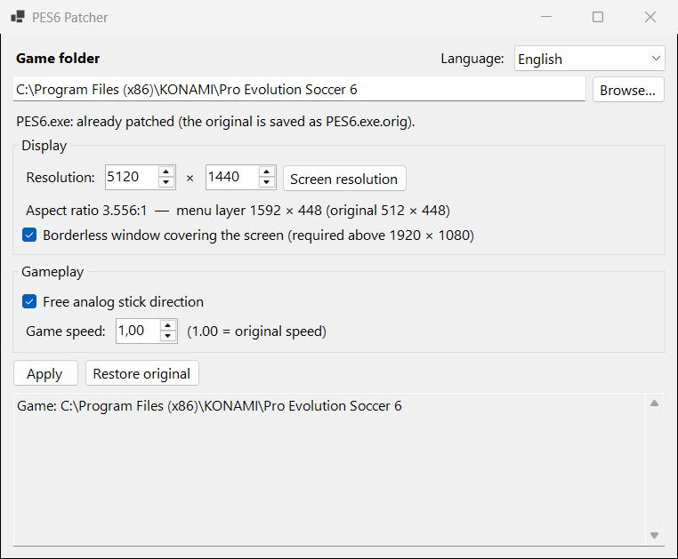

# PES6 Patcher

*English | [Français](README.fr.md)*

Patcher for **Pro Evolution Soccer 6 (PC)**: widescreen display without stretching (16:9, 21:9, 32:9…), free analog stick movement (including dribbling), optional close dribbling, and no intro at startup.



## What it does

**Widescreen display**
- Menus, lists, the HUD (score, clock, radar, names) and the player cursor are no longer stretched. They keep their original proportions, centred on the screen.
- The 3D image is adapted to the screen's aspect ratio through LOD Mixer.
- Above 1920 × 1080 (1440p and ultrawide screens), the game opens in a borderless window covering the whole screen.

**Gameplay**
- **Free analog stick direction**: the player follows the stick's precise angle instead of the 8 original directions only, when running and when dribbling (the ball is pushed at the stick's angle instead of the nearest multiple of 22.5°). The D-pad, the keyboard and the AI are unchanged.
- **Close dribbling** (optional): while dribbling, the player can only change direction at his next touch of the ball. This option makes the dribble touches shorter (× 0.875 when running, × 0.81 when sprinting), so the ball stays closer and the player follows the stick sooner. Passes and shots are unchanged.
- Adjustable **game speed** (Kitserver's Speeder module).
- **PityCharly's physics mod** (optional, separate download): stronger first-time and short passes, ball weight adjusted while dribbling. See [Physics mod](#physics-mod).

The rest of the gameplay is unchanged.

**Startup**
- **Skip the intro** (checked by default): no opening movie and no logos at startup. The language choice and the loading of the options file are kept.

## Requirements

- **PES6 PC with an unprotected executable** (no-DVD `PES6.exe` 1.00 / 1.10, or the exe of a community patch). See [Supported executables](#supported-executables).
- **[Kitserver 6](https://www.evoweb.uk/)**, with the LOD Mixer and Speeder modules. It sets the resolution and the 3D aspect ratio.
- **Windows 10/11** and the **[.NET 10 Desktop Runtime](https://dotnet.microsoft.com/download/dotnet/10.0)**.

## Usage

1. Close PES6 and `settings.exe`.
2. Run `PES6Patcher.exe`. It asks for administrator rights, because the game is installed in `Program Files`.
3. Check the game folder (detected automatically), the executable and the resolution (the screen's by default).
4. Choose the options, then click **Apply**. Each group (**Display**, **Gameplay**) and **Skip the intro** can be unchecked: for example, to change only the gameplay, uncheck **Display** and `kload.cfg`, `lodmixer.dat` and `settings.dat` are left as they are.

The exe is always rebuilt from the original backup, so the options can be changed and applied again at any time.

**Restore original** puts every file back as it was before the first apply.

Notes:
- After applying, do not reopen `settings.exe`: it does not know resolutions above 1920 × 1080 and would put the old value back.
- Stay in windowed mode in the game. The borderless window already covers the whole screen.

## Modified files

| File | Change | Backup |
|---|---|---|
| `PES6.exe` (or the selected executable) | patch (see below) | `PES6.exe.orig` |
| `kitserver\kload.cfg` | render resolution (a larger internal resolution with the same aspect ratio is kept), borderless window, physics mod line in the DLL list | `kload.cfg.orig` |
| `kitserver\lodmixer.dat` | 3D aspect ratio (left unchanged if its format is not recognised) | `lodmixer.dat.orig` |
| `kitserver\speeder.cfg` | game speed | `speeder.cfg.orig` |
| `Documents\KONAMI\Pro Evolution Soccer 6\settings.dat` | game resolution, checksum recomputed | `settings.dat.orig` |

## How it works

The game draws its menus in a layer inherited from the PS2, **512 × 448** units wide, then stretches it across the whole screen. The patch widens that layer to **448 × aspect ratio** units, for example 796 × 448 in 16:9. 3D rendering and gameplay keep using the original values.

| Part | Change |
|---|---|
| 2D layer → pixels conversion | 13 graphics instructions read new constants (half-width, 1/width) instead of 256 and 1/512. The gameplay instructions reading the same constants are left alone. |
| 2D layer width | The function returning 512 returns the new width. The two calls feeding the 3D projection keep 512, otherwise players "slide". |
| List clipping | Code added before the clip rectangle is converted to pixels. |
| Player cursor | Code added that adjusts the scale of the 3D → 2D layer projection. |
| Free directions | Code added around the direction bits → heading conversion: adds the offset between the stick's precise angle and the centre of its 45° sector. The running turn threshold goes from 45° to about 17°. For the most frequent dribble touch, whose direction the game rounds to 22.5°, code added at the entry of the ball kick function adds back what the rounding removed (for the pad whose stick gives that direction). |
| Close dribbling | Code added at the entry of the ball kick function: when the call comes from one of the 7 dribble touches (5 running, 2 sprinting), the kick speed is scaled down. |
| Intro | The game already skips the opening movie when asked to, and a skippable logo when a button is pressed: those two paths are always taken (3 conditional jumps made inactive). Loading during the logos still happens. |

The added code lives in unused padding areas of the exe.

## Supported executables

PES6 exists in several builds: 1.00 and 1.10, original or no-DVD, plus the executables shipped by community patches (`online_pes6.exe`, `offline_pes6.exe`…). The patch does not rely on fixed addresses: it **finds every location by signature**, that is the surrounding code with addresses left as wildcards, then derives the addresses it needs and cross-checks them (the constants must be 256.0 and 1/512, the calls must reach the expected functions…). Any build with the same game code is patched the same way, wherever that code lives.

The app shows, for the selected executable:
- **build tested in game**: the patch is known to work with it;
- **not tested in game yet**: every location was found, so it should work. Please report how it goes;
- **not supported**: some locations were not found. Nothing is changed.

Original executables with a DVD check may keep parts of their code encrypted by the copy protection; in that case the app reports them as not supported, and a no-DVD executable is needed.

**Copy report** puts a short report in the clipboard (file name, SHA-256, what can be applied, missing locations). Please share it, for example in the forum thread, so more builds can be confirmed.

Builds tested in game:

| SHA-256 | Notes |
|---|---|
| `3FE13850C933C85385F3FB5C45977D2DAA860D1FC03E95E97BE9F4FC24D81382` | no-DVD `PES6.exe`: widescreen (16:9, 32:9), free direction (running and dribbling), close dribbling and intro skip tested |

Addresses and method details (Ghidra, hardware breakpoints, memory captures) are in [`research/NOTES.md`](research/NOTES.md), in French. The scripts used during the research are in [`research/scripts`](research/scripts).

## Limitations

- Only one build has been tested in game so far; others are patched if their code matches (see above).
- Menu backgrounds are 512 units wide: black bars remain on the sides.
- Free directions apply to an analog stick only. Some less frequent dribble touches and special moves keep the game's own directions.
- Close dribbling: with players whose dribbling is weak (more irregular touches), the ball can occasionally end up under their feet.
- With two players on the same PC, the free direction picks the pad whose stick matches the dribble touch; this case has not been tested.

## Translations

The app is available in English and French. It follows the Windows language, and the language can be changed in the window.

To add a language: copy `src/PES6Patcher.Core/Resources/Strings.resx` to `Strings.<code>.resx` (for example `Strings.es.resx`), translate the values while keeping the `{0}`, `{1}`… placeholders, and open a pull request. The new language shows up in the app automatically, and the tests check that it has the same keys and placeholders as English.

## Building

```powershell
dotnet build
dotnet test
dotnet publish src/PES6Patcher -c Release -o publish -p:PublishSingleFile=true --self-contained false
```

Some tests compare the produced exe with exes validated in game. Those files come from the game, so they are not in the repository: without them, these tests pass without checking anything.

## Physics mod

[pes6_game_physics_mod](https://github.com/angelballay/pes6_game_physics_mod) by PityCharly is a Kitserver DLL that adjusts the power of passes (especially first-time passes) and the weight of the ball while the game runs. The patcher does not include it: it only switches it on or off in `kload.cfg`.

1. Download `pes6_game_physics_mod.zip` from [the mod's releases](https://github.com/angelballay/pes6_game_physics_mod/releases).
2. Copy **only** `pes6_game_physics_mod.dll` into the game's `kitserver` folder. Do not copy the `kload.cfg` from the archive: it would replace yours (DLL list, resolution).
3. In the patcher, check **PityCharly's physics mod**, then click **Apply**. Only its line is added to the DLL list (and removed when unchecked); the rest of `kload.cfg` is left as it is.

The mod uses the addresses of the tested `PES6.exe` build (see [Supported executables](#supported-executables)). It does not touch the code changed by this patcher. In game, Ctrl+Shift+P switches it on and off.

## Credits

- **Mod de Física Original creado por PityCharly.** ([pes6_game_physics_mod](https://github.com/angelballay/pes6_game_physics_mod), MIT licence with an attribution condition.)
- [Kitserver](https://www.evoweb.uk/) by juce and the Kitserver team.

## Disclaimer

Unofficial project, not affiliated with Konami. No game file is included: the app only modifies the installation present on the machine, after backing it up. Use at your own risk.

## License

[MIT](LICENSE)
