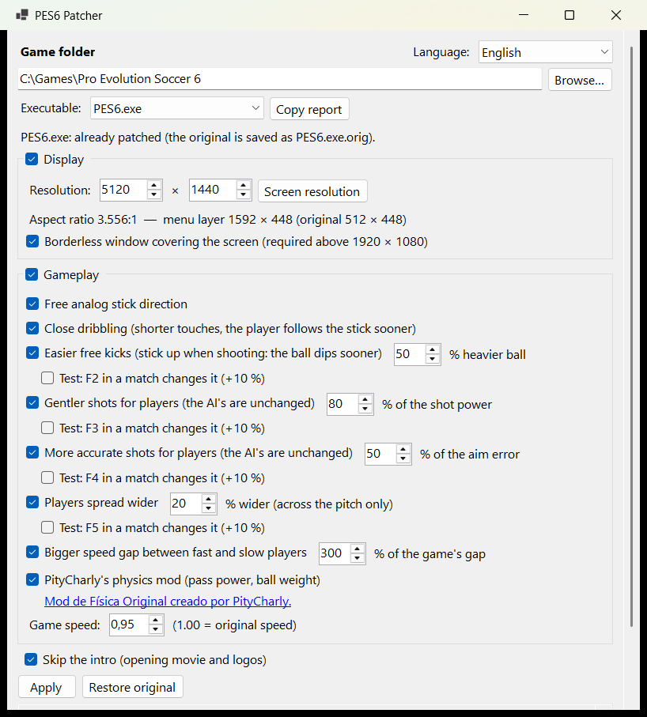

# PES6 Patcher

*English | [Français](README.fr.md)*

Patcher for **Pro Evolution Soccer 6 (PC)**: widescreen display without stretching (16:9, 21:9, 32:9…), free analog stick movement (including dribbling), optional close dribbling, easier free kicks, gentler and more accurate shots, and no intro at startup.



## What it does

**Widescreen display**
- Menus, lists, the HUD (score, clock, radar, names) and the player cursor are no longer stretched. They keep their original proportions, centred on the screen.
- The 3D image is adapted to the screen's aspect ratio through LOD Mixer.
- Above 1920 × 1080 (1440p and ultrawide screens), the game opens in a borderless window covering the whole screen.

**Gameplay**
- **Free analog stick direction**: the player follows the stick's precise angle instead of the 8 original directions only, when running and when dribbling (the ball is pushed at the stick's angle instead of the nearest multiple of 22.5°). The D-pad, the keyboard and the AI are unchanged.
- **Smaller analog stick dead zone** (on by default): the game zeroes each stick axis within 29 % of the centre, so a stick held up to about 16° away from up, down, left or right reads as exactly on that axis, and the player keeps running along a line. This option lowers that zone (**6 %** by default, from 2 to 20 %): a slight move of the stick now steers the player. It applies to both sticks; raise it if your pad drifts.
- **Close dribbling** (optional): while dribbling, the player can only change direction at his next touch of the ball. This option makes the dribble touches shorter, so the ball stays closer and the player follows the stick sooner. The reduction follows the player's dribble accuracy: none up to 65 (the game's own touches), full from 95 (× 0.875 when running, × 0.81 when sprinting), in proportion between, so good dribblers keep the ball closer than weak ones. Passes and shots are unchanged. In a match, **F1** switches it on and off; the state shows on screen for a moment (through Kitserver), and at kick-off.
- **Easier free kicks** (optional): after a direct free kick shot taken with the left stick pushed up, the ball is heavier until the next touch (+50 % by default, adjustable from 10 to 200 %; with the **Test** box, F2 in a match adds 10 % and shows the value, to find the right one), so it dips sooner after the wall. Without the stick up, and in the rest of the game, the ball keeps its weight; the keeper and the AI see the same trajectory.
- **Gentler shots** (optional): for the players' teams only, the power above the lightest shot is brought down (80 % by default, adjustable from 50 to 90 %; with the **Test** box, F3 in a match adds 10 % and shows the value). The AI's shots and set pieces are unchanged.
- **More accurate shots** (optional): for the players' teams only, the game's aim error (direction and height) is brought down (to 50 % by default, adjustable from 0 to 90 %; with the **Test** box, F4 in a match adds 10 % and shows the value), so a shot from an awkward position no longer flies far off target. A shot from the weak foot, which the game sends further off (and always to the same side), keeps the square of that share: 25 % at 50 %. A lob (L1 held) keeps its height, which is wanted and not an error, and gets less power (70 % by default, from 40 to 100 %), so it no longer flies over the keeper and the goal. The AI's shots and set pieces are unchanged (free kicks keep their height to clear the wall).
- **Players spread wider** (optional): the players placing themselves stand further from the centre of their team across the pitch (+20 % by default, adjustable from 10 to 40 %; F5 in a match with the **Test** box). The lines keep their height: only the width changes, which leaves more room to dribble and pass. Both teams are concerned.
- **Bigger speed gap between fast and slow players** (optional): in PES6, each point of the top speed stat is only worth 20 units of maximum running speed, so a player at 97 is barely 7 % faster than one at 68. This option makes the stat weigh more (300 % by default, adjustable from 100 % = the game to 400 %; with the **Test** box, F6 in a match adds 25 % and shows the value), around a player at 75 who keeps his speed: at 300 %, the gap becomes about 22 %. A fast winger can outrun a slower defender, with or without the ball. Both teams are concerned; the game recomputes the maximum speed during the match, so a change applies at once.
- **Sharper turns when sprinting, by dribble accuracy** (optional): sprinting with the ball, PES6 turns the ball by at most 22.5° per touch, one touch every 0.7 s, so a quarter turn takes about 3 seconds "in stages". With this option, the limit follows the player's dribble accuracy: the game's 22.5° up to 65, then more and more, up to the chosen maximum from 95 (90° by default, adjustable from 45°; with the **Test** box, F7 in a match adds 15° and shows the value). At a touch that turns the ball more than 22.5°, the player turns with it at once, on either foot, instead of running on along his old line. From 45° between the stick and the player (the game: 112°), the game's own turning animation plays instead of a sprint touch. Star dribblers can change direction sharply, weak dribblers keep the game's turns. Both teams are concerned.
- **The player turns faster with the ball** (optional): running with the ball, PES6 turns the player by at most 1.4° per frame, while a sharp touch sends the ball away at once: the player runs on along his old line for half a second and loses the ball by several metres. This option lets him turn up to **22° per frame** by default (about 16 times faster, adjustable from 3 to 45°), so he follows the ball. Both teams are concerned; it goes well with the sharper sprint turns.
- **Lofted passes: the press sets the distance, the stick the direction** (optional): a lofted pass (circle) aims at a team-mate chosen from the power gauge and the stick, but the gauge fills so fast that a short press already aims far, and the game takes any team-mate within 45° of the stick, so the pass feels fully assisted. With this option, a short or medium press aims clearly nearer (the same longest pass), and the receiver must be within 22.5° of the stick; with nobody there, the pass goes along the stick. Crosses are unchanged.
- **Through passes less far ahead of the receiver** (optional): a through pass reaches the right team-mate, but the game aims it far ahead of him, and on the wings it almost always goes out of play. This option shortens that lead (60 % by default, from 30 to 90 %; with the **Test** box, F9 in a match adds 10 % and shows the value), so the ball arrives in the receiver's run. Both teams are concerned.
- **Pressing players challenge for the ball from further** (optional): pressing with X, PES6 brings the player beside the carrier, but only tries to win the ball within 160 units, closer than where he stops, so he hardly ever challenges. This option widens that reach (180 % by default, adjustable from 120 %; with the **Test** box, F8 in a match adds 20 %, 100 % being the game's, and shows the value). Pressing players go in for the ball. Both teams are concerned.
- Adjustable **game speed** (Kitserver's Speeder module).
- **PityCharly's physics mod** (optional, separate download): stronger first-time and short passes, ball weight adjusted while dribbling. See [Physics mod](#physics-mod).

The rest of the gameplay is unchanged.

**Startup**
- **Skip the intro** (checked by default): no opening movie and no logos at startup. The language choice and the loading of the options file are kept.

## Requirements

- **PES6 PC with an unprotected executable** (no-DVD `PES6.exe` 1.00 / 1.10, or the exe of a community patch). See [Supported executables](#supported-executables).
- **[Kitserver 6](https://www.evoweb.uk/)**, with the LOD Mixer and Speeder modules. It sets the resolution and the 3D aspect ratio.
- **Windows 10/11** and the **[.NET 10 Desktop Runtime](https://dotnet.microsoft.com/download/dotnet/10.0)**.

## Usage

1. Close PES6 and `settings.exe`.
2. Run `PES6Patcher.exe`. It asks for administrator rights, because the game is installed in `Program Files`.
3. Check the game folder (detected automatically), the executable and the resolution (the screen's by default).
4. Choose the options, then click **Apply**. Each group (**Display**, **Gameplay**) and **Skip the intro** can be unchecked: for example, to change only the gameplay, uncheck **Display** and `kload.cfg`, `lodmixer.dat` and `settings.dat` are left as they are.

The exe is always rebuilt from the original backup, so the options can be changed and applied again at any time.

**Restore original** puts every file back as it was before the first apply.

Notes:
- After applying, do not reopen `settings.exe`: it does not know resolutions above 1920 × 1080 and would put the old value back.
- Stay in windowed mode in the game. The borderless window already covers the whole screen.

## Modified files

| File | Change | Backup |
|---|---|---|
| `PES6.exe` (or the selected executable) | patch (see below) | `PES6.exe.orig` |
| `kitserver\kload.cfg` | render resolution (a larger internal resolution with the same aspect ratio is kept), borderless window, physics mod line in the DLL list | `kload.cfg.orig` |
| `kitserver\lodmixer.dat` | 3D aspect ratio (left unchanged if its format is not recognised) | `lodmixer.dat.orig` |
| `kitserver\speeder.cfg` | game speed | `speeder.cfg.orig` |
| `Documents\KONAMI\Pro Evolution Soccer 6\settings.dat` | game resolution, checksum recomputed | `settings.dat.orig` |

## How it works

The game draws its menus in a layer inherited from the PS2, **512 × 448** units wide, then stretches it across the whole screen. The patch widens that layer to **448 × aspect ratio** units, for example 796 × 448 in 16:9. 3D rendering and gameplay keep using the original values.

| Part | Change |
|---|---|
| 2D layer → pixels conversion | 13 graphics instructions read new constants (half-width, 1/width) instead of 256 and 1/512. The gameplay instructions reading the same constants are left alone. |
| 2D layer width | The function returning 512 returns the new width. The two calls feeding the 3D projection keep 512, otherwise players "slide". |
| List clipping | Code added before the clip rectangle is converted to pixels. |
| Player cursor | Code added that adjusts the scale of the 3D → 2D layer projection. |
| Free directions | Code added around the direction bits → heading conversion: adds the offset between the stick's precise angle and the centre of its 45° sector. The running turn threshold goes from 45° to about 17°. For the most frequent dribble touch, whose direction the game rounds to 22.5°, code added at the entry of the ball kick function adds back what the rounding removed (for the pad whose stick gives that direction). |
| Stick dead zone | The pad reader zeroes each of the 4 stick axes (bytes 0-255, centre 128) when it is at most 37 from the centre (`cmp eax,25h`). The 4 limits are lowered in place (6 % of 127 = 8). The game's own centre dead zone, taken later on both axes together, is unchanged. |
| Close dribbling | Code added at the entry of the ball kick function: when the call comes from one of the 7 dribble touches (5 running, 2 sprinting), the kick speed is scaled down according to the player's dribble accuracy (the stat the game reads for the touch direction noise). |
| Free kicks | The set piece's call to the shot function goes through added code that flags the kick when a left stick is pushed up (the game reads the stick for the shot's spin at that same moment, and leaves it alone during the flight); the ball flight (also used by the trajectory predictions) then adds the chosen share of the ball weight until the next kick. The game's weight constant is left alone (PityCharly's physics mod changes it while the game runs). |
| Shots | The shot function's entry goes through added code that keeps the direction asked and, for a shooter of a human team, scales the power above the lightest shot; the shot's call to the kick function goes through code that brings the final direction and height back towards the ones asked (more accurate shots), more for a weak-foot shot (the animation's foot against the favoured foot, as the game checks it). Human teams are learnt from the active players' inputs matching the pads (a score per side that follows the half-time change). Set pieces keep the game's power. |
| Spread | The function setting where a player places himself (player, x, z) goes through added code: for a player placing himself, keepers excepted, the target is moved away from the centre of his team's targets across the pitch (z) by the chosen share. The length (x) is kept, so the lines keep their height. |
| Speed gap | Each player's maximum running speed is computed, and recomputed during the match, as 7542 + 12 × (top speed − 40) × 100 / 60 − 16 × fatigue, in an executable section of the protection. That computation jumps to added code that scales the stat's part by the chosen share, around a player at 75. |
| Sprint turns | At each sprint stride, the game turns the ball's direction from the player's (rounded to 22.5°) towards the stick by at most 22.5°. That limit is replaced by added code that computes it from the carrier's dribble accuracy. Before each of the two sprint touches (one per foot), more added code compares the new direction with the ball's current one and, when the turn is wider than 22.5°, turns the player's run and facing to it. One byte of the sprint stride hands turns from 45° (instead of 112°) to the normal dribble stride, which plays the turning animation. |
| Turns with the ball | Running with the ball, the game turns the player's facing and run direction towards their target by at most 0x100 (1.4°) per frame, in two places (`push 100h`, `add ecx,100h`). Both steps are raised in place to the chosen angle (22° = 0xFA5). |
| Pressing challenge | In the pressing state, the take-ball attempt is only asked for within 160 units of the ball, and the attempt itself only goes on within about 210 when running. Both limits are scaled by the chosen share (two values in the exe; with F8, a jump to added code that reads the share at run time). |
| Lofted pass aim | The lofted pass's receiver is chosen from the pass gauge (a distance wanted) and the stick. Two values of that choice are changed in the exe: the gauge-to-distance conversion becomes quadratic, and the cone around the stick goes from 45 to 22.5 degrees. |
| Pass lead | A pass point is placed ahead of the receiver by a lead built from his run. The two places that read that lead to place the point jump to added code that scales it by the chosen share (with F9, read at run time). |
| Intro | The game already skips the opening movie when asked to, and a skippable logo when a button is pressed: those two paths are always taken (3 conditional jumps made inactive). Loading during the logos still happens. |

The added code lives in unused padding areas of the exe.

## Supported executables

PES6 exists in several builds: 1.00 and 1.10, original or no-DVD, plus the executables shipped by community patches (`online_pes6.exe`, `offline_pes6.exe`…). The patch does not rely on fixed addresses: it **finds every location by signature**, that is the surrounding code with addresses left as wildcards, then derives the addresses it needs and cross-checks them (the constants must be 256.0 and 1/512, the calls must reach the expected functions…). Any build with the same game code is patched the same way, wherever that code lives.

The app shows, for the selected executable:
- **build tested in game**: the patch is known to work with it;
- **not tested in game yet**: every location was found, so it should work. Please report how it goes;
- **not supported**: some locations were not found. Nothing is changed.

Original executables with a DVD check may keep parts of their code encrypted by the copy protection; in that case the app reports them as not supported, and a no-DVD executable is needed.

**Copy report** puts a short report in the clipboard (file name, SHA-256, what can be applied, missing locations). Please share it, for example in the forum thread, so more builds can be confirmed.

Builds tested in game:

| SHA-256 | Notes |
|---|---|
| `3FE13850C933C85385F3FB5C45977D2DAA860D1FC03E95E97BE9F4FC24D81382` | no-DVD `PES6.exe`: widescreen (16:9, 32:9), free direction (running and dribbling), close dribbling, free kicks, gentler and more accurate shots and intro skip tested |

Addresses and method details (Ghidra, hardware breakpoints, memory captures) are in [`research/NOTES.md`](research/NOTES.md). The scripts used during the research are in [`research/scripts`](research/scripts).

## Limitations

- Only one build has been tested in game so far; others are patched if their code matches (see above).
- Menu backgrounds are 512 units wide: black bars remain on the sides.
- Free directions apply to an analog stick only. Some less frequent dribble touches and special moves keep the game's own directions.
- Close dribbling applies to every player, the AI included: its good dribblers keep the ball closer too, which makes defending them harder. Switch it off with F1 if defending feels too hard.
- With two players on the same PC, the free direction picks the pad whose stick matches the dribble touch; this case has not been tested.

## Translations

The app is available in English and French. It follows the Windows language, and the language can be changed in the window.

To add a language: copy `src/PES6Patcher.Core/Resources/Strings.resx` to `Strings.<code>.resx` (for example `Strings.es.resx`), translate the values while keeping the `{0}`, `{1}`… placeholders, and open a pull request. The new language shows up in the app automatically, and the tests check that it has the same keys and placeholders as English.

## Building

```powershell
dotnet build
dotnet test
dotnet publish src/PES6Patcher -c Release -o publish -p:PublishSingleFile=true --self-contained false
```

Some tests compare the produced exe with exes validated in game. Those files come from the game, so they are not in the repository: without them, these tests pass without checking anything.

## Physics mod

[pes6_game_physics_mod](https://github.com/angelballay/pes6_game_physics_mod) by PityCharly is a Kitserver DLL that adjusts the power of passes (especially first-time passes) and the weight of the ball while the game runs. The patcher does not include it: it only switches it on or off in `kload.cfg`.

1. Download `pes6_game_physics_mod.zip` from [the mod's releases](https://github.com/angelballay/pes6_game_physics_mod/releases).
2. Copy **only** `pes6_game_physics_mod.dll` into the game's `kitserver` folder. Do not copy the `kload.cfg` from the archive: it would replace yours (DLL list, resolution).
3. In the patcher, check **PityCharly's physics mod**, then click **Apply**. Only its line is added to the DLL list (and removed when unchecked); the rest of `kload.cfg` is left as it is.

The mod uses the addresses of the tested `PES6.exe` build (see [Supported executables](#supported-executables)). It does not touch the code changed by this patcher. In game, Ctrl+Shift+P switches it on and off.

## Credits

- **Mod de Física Original creado por PityCharly.** ([pes6_game_physics_mod](https://github.com/angelballay/pes6_game_physics_mod), MIT licence with an attribution condition.)
- [Kitserver](https://www.evoweb.uk/) by juce and the Kitserver team.

## Disclaimer

Unofficial project, not affiliated with Konami. No game file is included: the app only modifies the installation present on the machine, after backing it up. Use at your own risk.

## License

[MIT](LICENSE)
